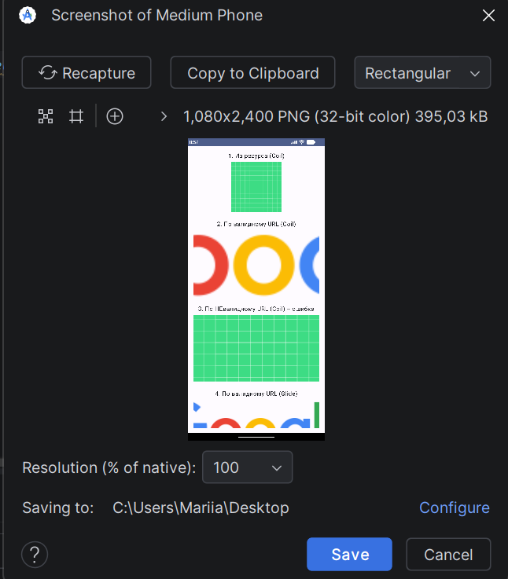

# Домашнее задание: Загрузка изображений

## Что сделано:
1. Создана ветка `homework_image_loading`.
2. Использованы 2 библиотеки: **Coil** и **Glide**.
3. Реализована загрузка изображения из ресурса (`R.drawable.ic_launcher_background`).
4. Реализована загрузка по валидному URL с отображением `placeholder` и самого изображения.
5. Реализована загрузка по невалидному URL с отображением `placeholder` и ошибки.

## Скриншот:
